# SDLPoP for AmigaOS 3.x / AmiCradle

SDLPoP is the open-source port of Jordan Mechner's Prince of Persia (1989),
made from the disassembly of the DOS game, with SDL 2 for display, sound and
input. GPL-3.0-or-later (upstream `COPYING`); `src/opl3.c` and
`src/stb_vorbis.c` carry their own licences. This repository holds the
AmiCradle port around upstream
[NagyD/SDLPoP](https://github.com/NagyD/SDLPoP) at
`3c5add5fb7f83d4ceb542823ab66d00146c4271b` (SDLPoP 1.24 RC, 24 December
2025): the patches, the build, the lab tools and the package. Target:
**AC090 / AmigaOS 3.x / 68040 + FPU**, libnix, SDL 2 through GFOpenGPU's
`SDL2.module` and `SDL2_image.module`.

## Game data

SDLPoP needs the original game's data (`data/`: the DAT files, the sprites,
the levels and the sounds). Upstream's repository carries it, but it is the
1989 game's, not SDLPoP's, and `STANDALONE.md` and `gameports/catalog.json`
say the commercial Prince of Persia data is not bundled: the user supplies
it. So this repository does not commit it and the package leaves it out.
`runtime-data/build-amiga.sh` stages upstream's `data/` at the pinned commit
for lab tests only.

## Building

The port never edits upstream's tree: `build-amiga.sh` fetches the pinned
commit (or takes `SDLPOP_SOURCE`, a local checkout holding it), applies
`patches/` to an exported copy with no fuzz, and compiles upstream's own
source list (`src/Makefile`) with upstream's flags (`-std=c99 -O2 -Wall`)
for the 68040 and FPU, linking the stove's `libSDL2.a` and `libSDL2_image.a`
(GFOpenGPU's link stubs).

Through Cradle (the build the lab tests use): `stove_build` with the stove
`os32-gcc16`, target `.` for the program, `package` for the LhA archive,
`runtime-data` for the lab's game data and `tests/lab` for the lab tools
(JoyPort, HoldKeys, Chop and Grab, which saves a rectangle of the screen
as a PNG). From a checkout, with a staged
stove:

```sh
STOVE=/path/to/os32-gcc16 OUT=build-amiga sh build-amiga.sh
```

`scripts/verify_gameport_stove.py` takes OpenAmigaGCC 16.2.0-open3 (archive
SHA-256 `9fcc136ab59e3bb5b91d2764d0bf290b709d72d7380be4ce0cdf005edf8eff21`),
16.2.0-open4 (`495319a2ffd803278f8827cad70074029c7aa9ecbe05d037e8646ba43ab94ab2`)
or GFOpenAmigaGCC 16.2.0-open5 (Cradle's `os32-gcc16` since the evening of
2 November 2026; no archive is published, so it is taken by `STOVE.json`'s
release and the compiler's own `--version`, and the receipt records the
SHA-256 of the compiler's own programs) and refuses any other.
`build-amigaos3.sh SOURCE OUT`, the earlier entry point, runs the same
build. The output is the drawer `SDLPoP/` (`prince`, upstream's
`SDLPoP.ini`, `COPYING`) and `receipt.json`, which names the compiler, the
patches' and the recipe's digests, the SDK inputs and the executable's
SHA-256; the receipts of the builds recorded here are in `receipts/`.

The patches, all AmigaOS only (`__amigaos__`):

- `0001-amigaos3-opengpu.patch`: `alloca` from the compiler, the current
  directory `PROGDIR:`, `logf` for the missing `log2f`.
- `0002-amiga-paths.patch`: files beside the program; SDLPoP.cfg,
  QUICKSAVE.SAV, PRINCE.HOF and screenshots in `PROGDIR:User`; the whole
  `SDLPoP.ini` read with libnix's `fscanf`; a `$VER` string.
- `0003-amiga-presentation.patch`: a 320x200 screen of the game's own by
  default (SDL's real full screen), `window` for a window, the renderer in
  the log, `fps` logging the frame rate.
- `0004-amiga-input.patch`: an input log (`SDLPOP_INPUT`), held keys
  released when the window loses focus, the fire button as Shift and the
  second button as jump on pads, Help for the screenshot, name entry
  without spinning the CPU.
- `0005-amiga-sound.patch`: the SDL audio driver and spec in the log, and
  with `fps` the mixer's buffers, late callbacks and mixing time.
- `0006-amiga-saves.patch`: replays in `PROGDIR:User/replays`
  (`SDLPoP.ini`), so the game writes only in `PROGDIR:User`.
- `0007-amiga-workbench.patch`: started from its icon, the game starts as
  from a Shell with no options (libnix gives it the WBStartup message for
  its arguments), and its log and SDL's go to `NIL:`, so no console
  window opens.

The package (target `package`, `package/build-amiga.sh`) builds the game
the same way, then `tools/make_package.py` (from amigaopentyrian) makes
`sdlpop-VERSION-68040.lha` with its `.sha256` and an Aminet-style
`.readme`: the drawer `SDLPoP` with `prince`, `SDLPoP.ini`, `ReadMe`,
`COPYING.txt`, their GlowIcons and `data/ReadMe.txt`, and the same drawer
as `SDLPoP.tar` for a lab. It checks that `prince` and `SDLPoP.ini` are
the ones the receipt names. The icons (`icons/`) are SDLPoP's own program
icon (upstream `src/icon.ico`, 32x32) made into OS 3.5 GlowIcons by
amicradle's `scripts/port_icons.py`:

```sh
python3 -I ../amicradle/scripts/port_icons.py icons/icons.json --out icons
```

regenerates the committed `.info` files byte for byte.

## Installing

Unpack the archive where you keep games (`lha x
sdlpop-1.24rc-3c5add5-amigaos3-test1-68040.lha Work:Games/`): it makes the
drawer `SDLPoP` with its icon. OS 3.2 has no `lha`; on AmiCradle,
`SYS:Utilities/OpenCompress x sdlpop-...-68040.lha Work:Games` does the
same (`OpenCompress t` tests it first). Put the game's `data/` drawer (the
DAT files; see Game data) in it, over `data/ReadMe.txt`. From a build
instead of the archive: make the drawer and put in it `prince`,
`SDLPoP.ini` and `COPYING` and the `data/` drawer.

The program needs GFOpenGPU's `SDL2.module` and `SDL2_image.module` in
`LIBS:GFOpenGPU/`, AHI for sound, and a 68040 or 68060 with its FPU. An
older system may have them only in `LIBS:OpenGPU/`; then the game stops at
once with `SDL 2: this program needs LIBS:GFOpenGPU/SDL2.module
(GFOpenGPU), which isn't installed.` (from an icon nothing appears). Make
the drawer and copy them in:

```
MakeDir LIBS:GFOpenGPU
Copy LIBS:OpenGPU/SDL2_image.module LIBS:GFOpenGPU/
Copy SDL2.module LIBS:GFOpenGPU/
Copy SDL2.module LIBS:OpenGPU/
```

with `SDL2.module` from gfopenrtg's main of 2 November 2026 or later
(older ones have no real full screen). Double-click `prince`, or from a
Shell: `Stack 262144`, then `prince` in the drawer.

## Running

`prince` with no options opens a 320x200 screen of its own, the game's own
frame, unscaled (SDL's real full screen through GFOpenGPU; upstream's
default is a 640x400 window, and its full screen is the desktop's size,
every frame scaled to it). `SDLPoP.ini`'s `start_fullscreen = false`, or
`prince window`, gives upstream's 640x400 window on the Workbench,
resizable; Alt+Return switches between the two, and from the window it
makes a screen of the window's size (640x400: each pixel doubled). `prince
fps` logs every second the game frames played, the screen updates and what
an update cost (`fps game 12.0, screen 12.0, update 2.07 ms (max 3.28) at
147.602 s`).

## Controls

Upstream's (`doc/Readme.txt`): the cursor keys run, jump and crouch, Shift
with them steps carefully, grabs a ledge and fights; Escape (or Backspace)
is the menu with quick save and settings, F6 quick-saves and F9 loads,
Space shows the time left, Ctrl+A restarts the level, Ctrl+Q quits,
Ctrl+Tab records a replay and Tab on the title plays them. The Amiga
keyboard has no F12: **Help** takes upstream's screenshot
(`PROGDIR:User/screenshots`; Shift+Help the level map).

Pads, AmigaOS only: the fire button is Shift and the second button jumps,
so a one-button stick or a CD32 pad plays it. Through GFOpenInput (SDL's
GameController, red A, blue B) A acts as upstream's X and B as Y; through
lowlevel.library alone (SDL_Joystick) red is X, blue Y, Play opens the
menu, and the stick's up and down count even with
`joystick_only_horizontal`. `SetEnv SDLPOP_INPUT RAM:input.txt` logs the
joysticks SDL finds and every key, text, focus, joystick and pad event
the game gets.

## Status

**TESTING**, not RELEASE (see Observed below and the release gates in
amicradle `docs/porting/MEASUREMENT.md`).

| Gate | State |
|---|---|
| Pinned source, reproducible build, receipts | done (open5, Cradle) |
| Start, info screen, title, intro, demo level, quit | done |
| Whole 320x200 frame on a screen of its own, frame rate measured | done (12.0 game frames a second, as the game's own timer gives) |
| Level 1 keyboard controls (run, turn, careful step, jump and climb, crouch) | done |
| Text input (a replay named), focus loss releasing held keys | done |
| Joystick / CD32 pad | not tested: no stick in the lab (SDL opens port 2 as a game controller); needs a person (For a person to check) |
| Sound | AHI opened and fed at 44.1 kHz, OPL3 music and effects mixed, late buffers rare (4 in 6,357); not heard (muted lab; For a person to check) |
| Quick save, saved game, settings and replays across a cold restart | done |
| Own drawer with GlowIcons, ReadMe, start from Workbench, LhA package | done |
| Fresh instance from the LhA alone: unpack on the Amiga, icon start, play, quick save, quit, cold restart, load | done (a new copy of Instance-32, 3 November 2026) |
| AGA without RTG, levels after the first, a person playing for a while | not done |

## Observed

### Build, 3 November 2026

Cradle `stove_build`, stove `os32-gcc16` (GFOpenAmigaGCC 16.2.0-open5),
target `.`:

| Commit | Job | Executable SHA-256 | Bytes |
|---|---|---|---|
| `3e9b058` (0001 only) | `j20261103T013956-4a8693` | `976f5f531608eab1f334a03d8015897552ce2e6fa1a781bb223cfccac7cdb2c8` | 593,424 |
| `65372f8` (0001, 0002) | `j20261103T015531-934dcf` | `4dd2efb6d181800f999a5db8ef7ae557224f63c10a1aeca28b78feb1aa9e32d0` | 593,352 |

The compiler's warnings are upstream's own (two `isspace` subscripts, one
always-true comparison), none in the patches. A local build with open3
gives the same warnings. Lab data (target `runtime-data`, job
`j20261103T014106-460abd`): 1,034 files, archive `510b70e5...`, `untar`
`2de6090b...`; lab tools (target `tests/lab`, job
`j20261103T014129-972d39`).

In `lab:sdlpop`, a copy of Instance-32 (AC090 JIT, 68040 + FPU, RTG
1920x1080, AHI, muted), with `SDL2.module` built by Cradle from gfopenrtg
main at `77fb11f` (job `j20261103T013628-da91df`, SHA-256
`eec57f96aa23fc26124b11e6ba0dbe25eb330d5c48ef4cb73f5d0475dd53a60b`,
1,002,284 bytes) in both `LIBS:OpenGPU/` and `LIBS:GFOpenGPU/`, and the
Instance's `SDL2_image.module` copied into `LIBS:GFOpenGPU/` (the program
stops without it there: `SDL2_image: this program needs
LIBS:GFOpenGPU/SDL2_image.module`); the game in `Work:Games/SDLPoP` with
its data unpacked by `untar`:

- `3e9b058`: upstream's 640x400 window on the Workbench (`OS3_FB: window
  surface in video RAM (640x400, 2560 bytes a row)`), the information
  screen, the title and Level 1, colours right; Ctrl+Q ended it. It also
  printed `short read from SDLPoP.ini!?`: libnix's `fscanf` gives EOF where
  glibc gives 0 at the end of the file, and upstream stopped reading the
  settings there.
- `c5705df` (0002's first form): every Ctrl+Q hung the whole lab (the CPU
  in a ROM loop with interrupts off). libnix frees its own `argv` strings
  at exit (`FreeVec` in `__exitcommandline`), and the patch had put a
  static string in `argv[0]`. `65372f8` gives the game a copy of the list
  instead.
- `65372f8`: no message about the settings, and `start_minutes_left = 42`
  added at the end of `SDLPoP.ini` under `[CustomGameplay]` gave "42
  MINUTES LEFT" in Level 1, so the whole file is read; Ctrl+Q from the
  information screen and from Level 1 ended it cleanly (three runs);
  `PROGDIR:User` was made at the start.

### Presentation, 3 November 2026

Commit `6eb1593` (`patches/0003-amiga-presentation.patch`, on top of 0001
and 0002): on AmigaOS the game's own 320x200 frame on a screen of its own by
default, `window` for upstream's window, the renderer and the output size
in the log, and `fps` logging each second. Executable (open5, Cradle job
`j20261103T020043-d57fff`): SHA-256
`f4613aaf92ee0e2652ef9ceb0649bcf126e1bba0e9a661096d80464fd0d267db`
(595,132 bytes; `receipts/2-presentation-open5-stove_build.json`).

In `lab:sdlpop` as for the build, `prince fps`, left to run from the
information screen through the title and the intro into the demo level:

- `OS3_FB: window surface in video RAM (320x200, 1280 bytes a row)` and
  `SDL renderer "opengpu" (flags 0xa), full screen 320x200, output
  320x200`: the RTG head switched to 320x200 and every screen filled it,
  frame whole; SDL picked GFOpenGPU's accelerated renderer (`opengpu`,
  render targets supported), so upstream's texture path runs as it is.
- The game's logic runs on its own timer: in the demo level **12.0 game
  frames a second** in all six readings (11.9 at the lowest), which is
  what the original's 60 Hz timer and its 5-tick frame give, and the
  screen was updated once a game frame. An update (upstream's surface to
  texture to screen) took **1.8 to 3.1 ms on average**, 11.6 ms at most;
  at 12 frames a second that is about 3 per cent of the time.
- In the title and the intro, which redraw on their own timers, 26 to 53
  updates a second at 1.6 to 6.3 ms each on average; the longest single
  update in the 150 s was 215 ms, once, while the intro's music and
  pictures were being loaded.
- `prince window`: `window 640x400, output 640x400`, the information screen
  and the title in a window on the Workbench, each pixel doubled;
  Alt+Return gave a 640x400 screen of its own and Alt+Return again the
  window. Ctrl+Q ended every run cleanly, back to the Workbench.


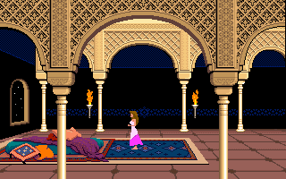

### Controls, 3 November 2026

Commit `331f1ed` adds `patches/0004-amiga-input.patch`, `7935e72` finishes
it after the first lab run (the log's name read with `SDL_getenv`, which
sees `SetEnv` variables where libnix's `getenv` did not; Help for the
screenshot; name entry no longer spinning). Executable (open5, Cradle job
`j20261103T021336-3a33f5`): SHA-256
`50f5fc8e783b42cd2b44b9ea5ad9868ff6bdbe7c6db46896a64cd4db3761e654`
(598,016 bytes; `receipts/3-input-open5-stove_build.json`; the first,
`331f1ed`, job `j20261103T020857-9b633d`, in
`receipts/3-input-331f1ed-open5-stove_build.json`).

The catalogue's gate was "check the SDL2 text input/focus fix and confirm
Level 1 keyboard controls". Earlier runs on an older SDL2 runtime typed
nothing into Neverball's name field, and SDLPoP's movement was only tried
while paused. In `lab:sdlpop` with gfopenrtg main's `SDL2.module`:

- **Level 1 from the keyboard**, on its own screen, unpaused, with HoldKeys
  holding the keys as a player would (`tests/lab`): Right ran the kid off
  the starting ledge to the floor below; Left turned him and ran him back
  under it; Up jumped, caught the ledge and climbed it; Shift+Left stepped
  carefully to its edge; Down crouched (the picture taken with the key
  held); Right again ran him on into the next room, where the guard killed
  him (no sword yet: "Press Button to Continue"). The input log has every
  press and release with its time (`key Right down` ... `key Right up`,
  1.74 s later for a 1-second HoldKeys, its ticks being slow in the lab).
- **Text input**: Ctrl+Tab started a replay, Ctrl+Tab stopped it and the
  game asked for its name; `amiga1` typed through Cradle's keyboard,
  Backspace, `2`: the field showed `amiga2_`, Return saved
  `PROGDIR:replays/amiga2.p1r` (3,962 bytes). SDL gave the text events
  (`text " "` beside `key Space down` in the log). Before the change the
  name field redrew about 1,600 times a second; it now waits 10 ms a turn.
- **Focus**: in a window (`prince window`), Right held and the Workbench
  clicked: the log has `key Right up` and `focus lost` at the same
  millisecond (SDL releases the keys it saw down when the window loses
  focus), and the kid stopped behind the doorway's pillar instead of
  running on into the guard's room; `focus gained` when the window was
  clicked again, no key stuck. The patch's own release of held keys and
  pad buttons on focus loss stays as a second guard.
- **Screenshots**: Help printed "Saved screenshot" and wrote
  `PROGDIR:User/screenshots/screenshot_000.png` (320x200; the pictures
  below are those files).
- Frames: 12.0 game frames a second in every reading of play, an update
  0.8 to 1.5 ms on average.


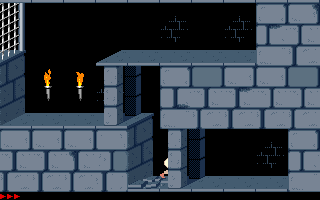
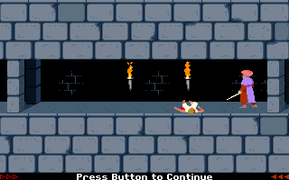

Joystick and CD32 pad: not qualified. The lab has no stick: JoyPort reports
lowlevel.library's port 1 (game port 2) as `none`. SDL lists `joystick 0:
"Amiga joystick port (2): joystick", game controller` (GFOpenInput's
layout) and the game takes it through SDL_GameController; no stick or pad
event was made. The mapping (fire as Shift, second button jump, Play the
menu) is untested; a person with a stick or a CD32 pad has to try it.

### Sound, 3 November 2026

Commit `cf04fb9` adds `patches/0005-amiga-sound.patch`: upstream's mixer is
unchanged. It mixes the digitised sound effects and, for the music, plays
the game's own MIDI scores through `opl3.c` (an emulated OPL3 FM chip,
Nuked OPL3), all in software on SDL's audio callback (Ogg music only if
the user adds files to `data/music`; none here). On AmigaOS the patch logs
the audio spec, and with `fps` it logs every five seconds the buffers
filled, the callbacks that came more than half a buffer late and the
mixing time. Executable (open5, Cradle job `j20261103T022000-7e4ad6`):
SHA-256 `5bcba9f70c9b61a4aeba20e61e631a01f68cbca0a0147517d0df29b024fa1934`
(599,148 bytes; `receipts/4-sound-open5-stove_build.json`).

In `lab:sdlpop`, `prince fps`: the title and intro with their music
(about 70 s), then Level 1 for 80 s with
`HoldKeys 40 CYCLE 4F,4C,4E,4D PERIOD 60` (the kid running, jumping,
climbing and landing), then Ctrl+Q:

- `SDL audio "ahi": 44100 Hz, 2 channels, 1024 samples a buffer, format
  0x9010`: SDL's AHI driver, 16-bit big-endian stereo, 23.2 ms buffers, as
  upstream asks.
- **6,357 buffers** over the run, 215 to 230 in each five-second reading
  (the readings are 5.0 to 5.3 s apart: 43 a second, as 44,100 / 1,024
  gives). **4 came late**, all while the music played (4 of 2,747
  buffers then, 0.15 per cent); none in Level 1.
- **Mixing**: with the OPL3 music, **5.7 to 13.2 ms on average** for each
  23.2 ms buffer (25 to 57 per cent of the time it plays for), 46.9 ms at
  the very most; in Level 1 (sound effects, no music) 0.01 to 0.02 ms, 2.0
  ms at most. The FM synthesis is the cost: Nuked OPL3 makes its samples at
  the chip's own 49,716 Hz whatever the output rate, so a lower SDL rate
  would not make it cheaper.
- Frames held at 12.0 game frames a second in Level 1 throughout (11.8 at
  the lowest, the reading as the level started).
- The lab did not freeze (amicradle #790's AHI race); Ctrl+Q ended the game
  with sound on, back to the Workbench.

Labs are muted: AHI was opened and fed at the full rate, which is what a
muted lab can show. That the music and effects sound right, and whether the
rare late buffer while the music plays can be heard, is for a listening
test on a real instance.

### Saves: quick save, saved game, settings and replays, 3 November 2026

SDLPoP keeps the in-game settings in `SDLPoP.cfg` (it overrides
`SDLPoP.ini` while the ini is older, and is dropped when the program
changes: it carries the executable's checksum), the quick save in
`QUICKSAVE.SAV`, the original game's save (Ctrl+G, from level 3) in
`PRINCE.SAV`, the hall of fame in `PRINCE.HOF` and recorded replays as
`.p1r` files. 0002 put the first four in `PROGDIR:User`; commit `8b52ef0`
adds `patches/0006-amiga-saves.patch`, which puts the replays there too.
Executable (open5, Cradle job `j20261103T022540-340c41`): SHA-256
`5bcba9f70c9b61a4aeba20e61e631a01f68cbca0a0147517d0df29b024fa1934` (the step
4 build's: 0006 changes only `SDLPoP.ini`, now `78c1c828...`;
`receipts/5-saves-open5-stove_build.json`).

In `lab:sdlpop`, the earlier `PROGDIR:User` moved aside, so the game
started with none:

- Level 1: the kid run into the room left of the start, F6: "QUICKSAVE",
  `User/QUICKSAVE.SAV` (3,467 bytes).
- Escape, Settings, Visuals, "Torch shadows enabled" on, Escape: the room
  darkened away from its torches and `User/SDLPoP.cfg` (734 bytes) was
  written.
- `prince megahit 3` (upstream's level select), Ctrl+G: "GAME SAVED",
  `User/PRINCE.SAV` (8 bytes); the torch shadows were on from the first
  frame (the settings read back). Ctrl+Tab, a few steps, Ctrl+Tab, `lvl3`,
  Return: `User/replays/lvl3.p1r`. Nothing was written outside `User`
  (no `PROGDIR:replays`).
- **Across a restart:** the lab was stopped and started again (a cold
  boot). Every file in `PROGDIR:User` was still there with its size and
  time. `prince`, then on the title: F9 quick-loaded Level 1 in the saved
  room with the kid where he was saved, torch shadows on; Ctrl+Q,
  `prince` again, Ctrl+L on the title: Level 3 from `PRINCE.SAV` with no
  level select; Ctrl+Q, `prince`, Tab on the title: the replay `lvl3`
  played ("LEVEL 3").

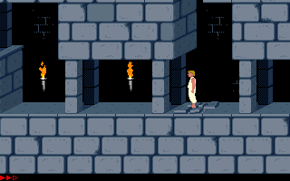
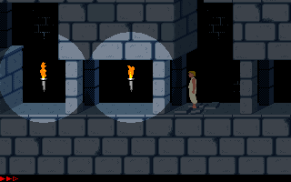

Not covered: the hall of fame (it needs the game won), a full disk or a
write-protected drawer.

### Package: the drawer, its icons and the start from Workbench, 3 November 2026

Built by Cradle's `stove_build` of `3a06a94`, target `package` (job
`j20261103T023514-1c0c68`, `receipts/6-package-open5-stove_build.json`):
`sdlpop-1.24rc-3c5add5-amigaos3-test1-68040.lha`, 310,665 bytes, SHA-256
`d0d998e2...`, nine members; `prince` 599,360 bytes, SHA-256
`f5962362...` (0007 changes the program; `SDLPoP.ini` is step 5's).
The archive holds `SDLPoP.info` and the drawer `SDLPoP/` with `prince`,
`prince.info`, `SDLPoP.ini`, `ReadMe`, `ReadMe.info`, `COPYING.txt`,
`COPYING.txt.info` and `data/ReadMe.txt`; no game data. Read back with
`tools/lha_archive.py` (lh5 decoded, every CRC checked), a local package
build's archive gave the same nine members byte for byte as the drawer
it was made from.

In `lab:sdlpop` there is no `lha`, so the same drawer went in from the
job's `SDLPoP.tar` (untar) as `Work:Games/SDLPoP`, with the lab's game
data in its `data` drawer (the earlier test drawer moved aside to
`SDLPoP.lab`):

- **Icons:** the Games window shows the drawer as a GlowIcon with the
  game's own art as its badge; the drawer opens on `COPYING.txt`,
  `prince` (the kid's head on the tool's gears) and `ReadMe`.
- **From Workbench:** a double-click on `prince` opened the info screen on
  the game's own 320x200 screen, then the title and Level 1; no console
  window opened beside it (0007). Help wrote
  `User/screenshots/screenshot_000.png`; Ctrl+Q went back to the
  Workbench, the drawer as it was.
- **ReadMe:** a double-click opened it in a text viewer (the icon's
  default tool is `SYS:Utilities/MultiView`, which on the lab's system is
  OpenView).

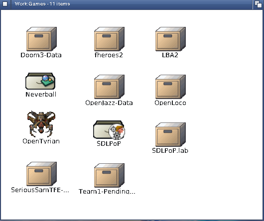
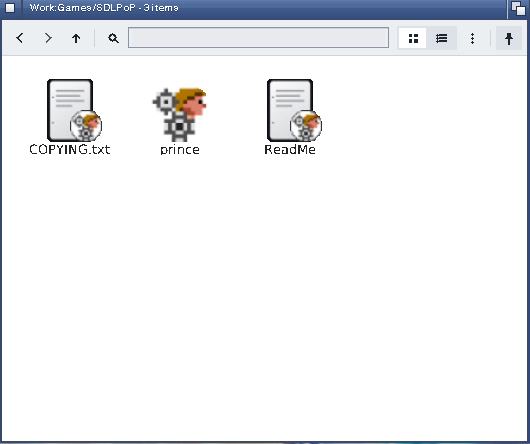

(Grabbed in the lab with `tests/lab`'s Grab as PNG: `Grab SYS:T/wb.png X Y
W H` saves that rectangle of the frontmost screen.)

Not covered: `lha x` on the Amiga (the archive was read back on Linux
only), `COPYING.txt` opened from its icon, a Workbench with no GlowIcon
support (OS 3.1).

### Play test on a fresh instance, from the LhA alone, 3 November 2026

Built by Cradle's `stove_build` of `479d109`, target `package` (job
`j20261103T032459-07ab20`, `receipts/7-playtest-open5-stove_build.json`):
`sdlpop-1.24rc-3c5add5-amigaos3-test1-68040.lha`, 310,666 bytes, SHA-256
`2760680c160bba420f15d4ac2070ca5cac5e898d30086e7c12445d23f36be57a`. Its
`prince` is step 6's (`f5962362...`); only the ReadMe changed, which now
names the compiler GFOpenAmigaGCC.

`lab:sdlpop-fresh`, a new copy of Instance-32 (AC090 JIT, RTG, muted), with
nothing of the game on it. Put in from outside: the archive, gfopenrtg's
`SDL2.module` (main `77fb11f`, job `j20261103T013628-da91df`), and, for
the game data the user supplies, upstream's `data/` as the lab-only tar
(`runtime-data`, job `j20261103T014106-460abd`) with `untar`. Then, on the
Amiga:

1. `OpenCompress t` on the archive: "9 files tested, 692580 bytes, all
   good". `OpenCompress x` into `Work:Games`: "9 files extracted";
   `Work:Games/SDLPoP.info` and the drawer. The unpacked `prince`,
   `SDLPoP.ini`, `ReadMe`, `prince.info` and `SDLPoP.info` have the job's
   SHA-256s.
2. Before the modules were in, `prince` from a Shell stopped at once (return
   code 20): `SDL 2: this program needs LIBS:GFOpenGPU/SDL2.module
   (GFOpenGPU), which isn't installed.` The instance has SDL 2 only in
   `LIBS:OpenGPU/` and no `LIBS:GFOpenGPU/`. Made as Installing says:
   `LIBS:GFOpenGPU/` with gfopenrtg's `SDL2.module` and the instance's own
   `SDL2_image.module`, and gfopenrtg's `SDL2.module` in `LIBS:OpenGPU/`
   too. The data went into the drawer's `data` (1,034 files).
3. On the Workbench: Work, Games (the SDLPoP drawer's GlowIcon), SDLPoP
   (`COPYING.txt`, `prince` and `ReadMe` with theirs). `prince` chosen and
   opened (Right-Amiga O): the info screen on the game's own 320x200
   screen, no console window, then the title.
4. Return started Level 1. Played with `tests/lab` HoldKeys: Right ran the
   kid off the first ledge to the floor below and into the next room, Left
   back across it. F6 showed "QUICKSAVE" and the game made `User/` with
   `QUICKSAVE.SAV` (3,467 bytes, SHA-256 `c9b84fa9...c28a`). Left again
   moved the kid away from where he was saved; Ctrl+Q went back to the
   Workbench and `prince` was gone from `Status`.
5. **Cold restart**: the lab stopped and started. `User/QUICKSAVE.SAV` had
   the same SHA-256.
6. From the icon again (Work, Games, SDLPoP, `prince`), Return on the info
   screen, F9 on the title: the saved room with the kid where he was saved.
   Beside the picture taken at the save, only the torch flames and the
   status line differ. Ctrl+Q went back to the Workbench.
7. `COPYING.txt` from its icon opened in OpenView (its default tool,
   `SYS:Utilities/MultiView`). The game wrote nothing outside its drawer;
   `User/QUICKSAVE.SAV` was all it wrote.

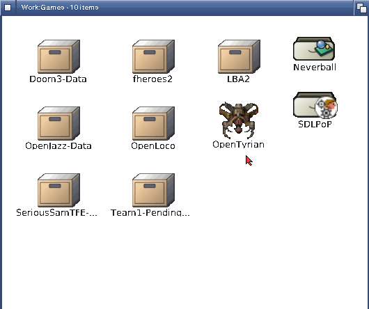
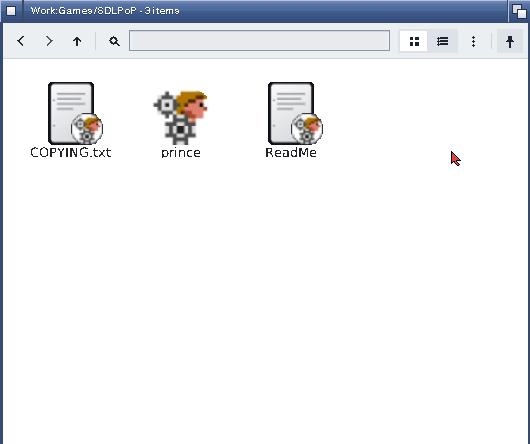
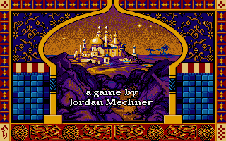
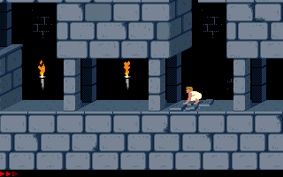
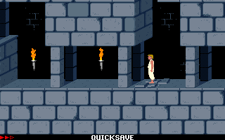
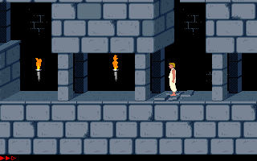

(The game pictures are Cradle's screenshots of the RTG head at 320x200;
the Workbench ones are its 1920x1080 screenshots cut to the window.)

This also covers what step 6 left: `lha` on the Amiga (OpenCompress) and
`COPYING.txt` from its icon. Not covered: a Workbench with no GlowIcon
support (OS 3.1), and the items in For a person to check.

## For a person to check

These need hands or ears; the lab has neither a stick nor sound.

**Pad.** On an instance with a joystick or CD32 pad in port 2 (or a USB pad
the instance's window passes to port 2):

1. Install as Installing says, then open a Shell and type
   `SetEnv SDLPOP_INPUT RAM:input.txt`.
2. Start `prince` from its icon, press Return on the info screen and the
   title.
3. In Level 1, push the stick left and right (the kid runs), up (he jumps),
   down (he crouches); hold fire and push left or right (a careful step);
   press the second button (he jumps). On a CD32 pad press Play (the menu
   opens; Play again closes it).
4. Ctrl+Q, then `Type RAM:input.txt` in the Shell. It should list the pad
   SDL found and a `pad` or `joy` line for each press. Note anything that
   did not move the kid.

**Sound.** On an instance with sound on: start `prince` from its icon and
listen to the title music (about a minute), then play Level 1 for a few
minutes. The music and the effects (steps, the gate, the guard's sword)
should be clear. Note any crackle or gap, with the time and what was
playing.
